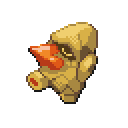
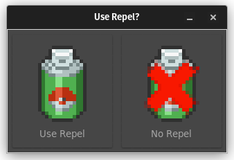
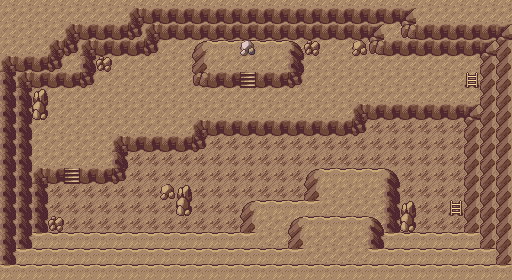
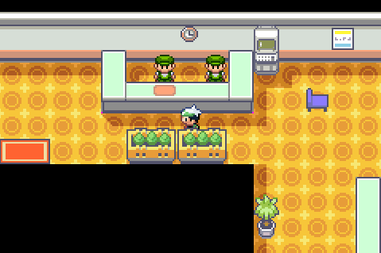

🏠 [`pokebot-gen3` Wiki Home](../Readme.md)

# 🗿 Rock Smash Mode

Rock smash mode will continuously farm Rock Smash encounters in Granite Cave (Nosepass) and Safari Zone (Shuckle).

## Granite Cave

You can use this mode either with or without Repel.  
If using Repel, the bot will use up any Repel items in your inventory and then reset once it ran out.

Using Repel on its own give a minor boost to encounter rates (around +5%), but there are two ways to
boost encounter rates significantly (that both require Repel to be used):

1. If you have a **White Flute** in your inventory, the bot will use that as well and in combination
   that can boost encounters by **up to 40%**.
2. If you have a Pokémon with the ability **Vital Spirit** or **Pressure** as the first Pokémon in
   your party, that can give you **another 35% boost** to Nosepass encounters.

A good candidate for a Pokémon with such an ability would be Vigoroth -- which you can get by catching
a Slakoth in Petalburg Woods and evolving it at level 18. Because that level would be too high for the
Repel strategy, you should _make it faint_ (its ability will still work) and put it in the first slot
of your party, and then put a non-fainted level-13 Pokémon in the second slot (because Repel works with
the level of the first _non-fainted_ Pokémon.)

If you have any Repel items in your inventory, the game will offer you this choice:

### Without Repel

- Go to the bottom floor of Granite Cave (B2F)
- Start mode

### With Repel

- Make sure you have **at least two full stacks (2 × 99) of Max Repel or Super Repel** in your inventory, and
  preferably more. Max Repel works best. Plain Repel lasts only half as long as Super Repel, so you would need
  four stacks of those.  
  The bot only resets once it has used up all of your Repels. Two stacks of Super Repel give you about 400 encounters
  before that happens. Every reset takes time, and in Emerald, the more often the bot resets, the more likely it
  is to encounter the same Pokémon again (see [the note on soft resets](#note-on-soft-resets-in-emerald) below.)  
  The bot can work with as few as 1 Repel. In Emerald, it will warn you the first time you start the mode with
  fewer than recommended. Select the mode again to start it anyway.
- Optional, but highly recommended: Get the White Flute.
- Optional, but highly recommended: Get a Pokémon with the ability Vital Spirit or Pressure as the first Pokémon.
- Make sure the first non-fainted Pokémon in your party has level 13. The bot will accept Pokémon up to level 16, but
  13 gives you the best rates.
- Go to the bottom floor of Granite Cave (B2F)
- **Save the game**
- Start mode and select 'Use Repel'

## Safari Zone

(This area only exists in Emerald.)

The mode will continuously try to enter the Safari Zone, so make sure you have some cash. The bot will first **use up all the player's cash in Safari Zone entrance fees** and then soft reset to start over.

- Go to the _entrance_ of the Safari Zone (see image below)
- Make sure you have some cash on you. In Emerald, we recommend at least **₽250,000**, which is enough for about
  1,700 encounters before the bot has to reset. If you have less, the bot will warn you the first time you start
  the mode. Select the mode again to start it anyway.
- (Optional) Register the Mach Bike to the Select button (this is not required, but it will be a bit faster.)
- Save the game (**in-game, not a save state**)
- Start mode

## Note on soft resets in Emerald

Emerald starts its random number generator from the same value every time the game is reset. Without
countermeasures, the game tends to end up in the exact same state after each reset, and the bot would keep
encountering the same Pokémon over and over again.

To prevent that, the bot waits for a random moment on the 'Would you like to use Rock Smash?' question:
up to about 4 seconds for the first rock after a reset, and up to a quarter of a second for every other rock.
This is not necessary, and so not done:

- in Ruby and Sapphire, which start their random number generator differently,
- in Granite Cave without Repel, because the bot never resets in that case,
- during your very first run in Granite Cave (with Repel) or in the Safari Zone, until the first reset. The bot
  remembers that it has done such a run in `flags.txt` in your profile directory. (If you delete that file or
  the relevant line in it, the next run will be without waiting again, but it might then repeat encounters
  from your earlier runs.)

**Every reset makes the hunt a bit slower and makes repeated encounters more likely, so bring at least the
recommended amount of Repels (Granite Cave) or cash (Safari Zone), and preferably more.**

If you have enabled the [`random_soft_reset_rng` cheat](Configuration%20-%20Cheats.md), the bot will skip
the waiting time.

## Game Support
|          | 🟥 Ruby | 🔷 Sapphire | 🟢 Emerald |
|:---------|:-------:|:-----------:|:----------:|
| English  |    ✅    |      ✅      |     ✅      |
| Japanese |    ✅    |      ✅      |     ✅      |
| German   |    ✅    |      ✅      |     ✅      |
| Spanish  |    ✅    |      ✅      |     ✅      |
| French   |    ✅    |      ✅      |     ✅      |
| Italian  |    ✅    |      ✅      |     ✅      |

✅ Tested, working

🟨 Untested, may not work

❌ Untested, not working
