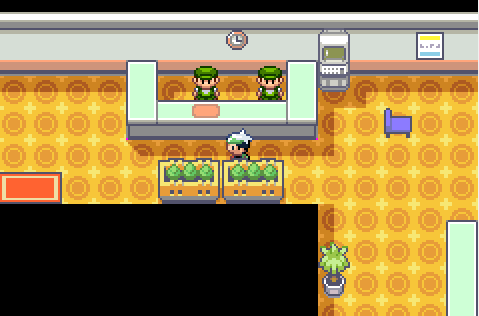
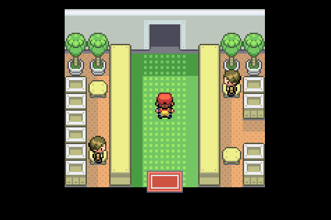
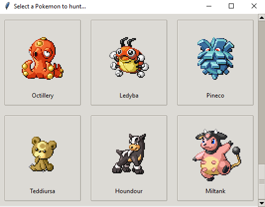
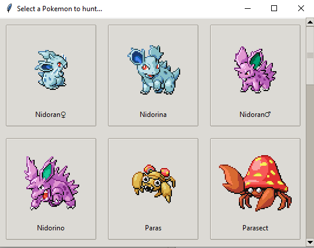
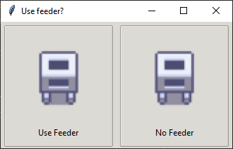
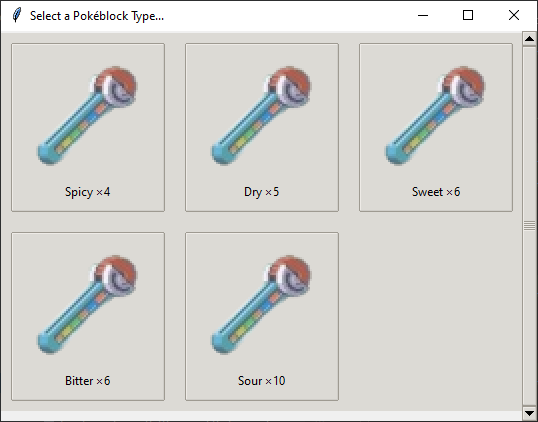
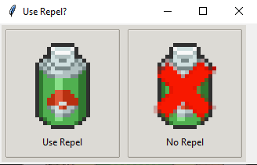

🏠 [`pokebot-gen3` Wiki Home](../Readme.md)

# 🏞️ Safari Mode

The **Safari Mode** allows you to continuously hunt Pokémon in the **Safari Zone**.

---

## How Safari Mode Works

Safari Mode lets you select a specific Pokémon to hunt in the Safari Zone. The bot navigates to a predefined tile and uses the best strategy to locate and catch the target Pokémon.

Safari Mode uses the appropriate hunting strategy based on the target Pokémon and its environment:

- **Spin**
- **Surf**
- **Fish**

---

## Requirements

Before starting Safari Mode, ensure you meet the following criteria:

1. **Save your game** at the Safari Zone entrance building at **Route 121** (`Ruby`/`Sapphire`/`Emerald`) or in **Fuchsia City** (`FireRed`/`LeafGreen`).

2. **Have enough money**: You need more than ₽500 to start the hunt. In `Emerald`, we recommend at least
   **₽10,000** (more if you use a custom catch filter that matches often, see the note on soft resets below.)
   If you have less, the bot will warn you the first time you start the mode. Select the mode again to
   start it anyway.
3. **Choose a Pokémon** to hunt from the available Safari Zone list.

- `Ruby` / `Sapphire` / `Emerald`
4. **Decide whether to use Feeder**, this option becomes available for most Pokémon once you have at least two Pokéblocks of the same flavor (Spicy, Sour, Bitter, etc.). You can then select which type of Pokéblock you want to place in the feeder.

5. **Decide whether to use Repel**, especially for Pokémon not hunted by Fishing. Since some targets are located far from the Safari entrance, ensure you have enough repels to do a full cycle (4 re-entries) before a soft reset.

---

## Mode Behavior

1. The bot navigates to the predefined tile for your selected target.
2. If a Pokémon of interest (e.g., Shiny or meeting a custom catch filter) appears, the bot will attempt to catch it.

- `Ruby` / `Sapphire` / `Emerald`

The `auto_catch` Safari strategy for `Ruby` / `Sapphire` / `Emerald` is designed using an in-depth
[study](https://www.docdroid.net/oiHhrwd/hoenn-safari-zone-research-pdf), which calculate the most effective Pokéblock and Safari ball sequence for catching a Pokémon based on the Pokémon encountered.
The bot will use your Pokéblock case if you have some available to perform the strategy, or throw balls until the target is captured.

- `Fire Red` / `Leaf Green`

The `auto_catch` Safari strategy for `Fire Red` and `Leaf Green` is designed using an in-depth
[study](https://www.docdroid.net/Tx5NbeU/safari-zone-research-pdf),
which calculate the most effective sequence for catching a Pokémon based on both the Pokémon encountered and
the number of Safari Balls remaining at the start of the encounter.
The bot will use the best possible bait / ball strategy until the target is captured.

The bot uses optimal catch patterns, which are available in these
[lookup tables](https://www.docdroid.net/g3I5Qtl/frlg-lookup-tables-pdf), to maximize catch rates for each Pokémon.

3. If you used atleast one safari ball, the bot will exit the Safari and re-entry if you have enough money or soft reset. Since some Pokémon catching can take 20+ Safari balls, you might want to have a full bag when finding that Shiny Chansey.
   As the bot doesn't use up any steps while hunting, it only leaves the Safari Zone after such a catch attempt.
4. Once you have less than ₽500 left, the bot will:
    - Perform a soft reset to get your cash back, if it hasn't caught any Pokémon since the last reset.
    - Or exit Safari Mode and switch to manual control for you to save your game if a Pokémon was captured since the last reset.

---

## Note on soft resets in Emerald

Emerald starts its random number generator from the same value every time the game is reset. Without
countermeasures, the game tends to end up in the exact same state after each reset, and the bot would keep
encountering the same Pokémon over and over again.

To prevent that, the bot waits for a random moment at a few points: up to about 4 seconds after entering the
Safari Zone and again after arriving at the hunting spot, and up to a quarter of a second after every battle.
This is not necessary, and so not done:

- in Ruby, Sapphire, FireRed and LeafGreen, which start their random number generator differently,
- during your very first run, until the first reset. The bot remembers that it has done such a run in
  `flags.txt` in your profile directory. (If you delete that file or the relevant line in it, the next run
  will be without waiting again, but it might then repeat encounters from your earlier runs.)

This makes the bot avoid long runs of repeated encounters, but it cannot rule out that an individual encounter
repeats one from an earlier run, and this gets more likely the more often the bot resets.
As the bot only uses up an entry after a failed catch attempt, **₽10,000** (20 entries) is usually enough.
If you use a custom catch filter that matches often, bring more cash.

If you have enabled the [`random_soft_reset_rng` cheat](Configuration%20-%20Cheats.md), the bot will skip
the waiting time.

---

## Game Support

> ⚠️ **Warning**: The feeder feature doesn't work for other languages than English

|              | 🟥 Ruby | 🔷 Sapphire | 🟢 Emerald | 🔥 FireRed | 🌿 LeafGreen |
|:-------------|:-------:|:-----------:|:----------:|:----------:|:------------:|
| **English**  |    ✅    |      ✅      |     ✅      |     ✅      |      ✅       |
| **Japanese** |    ✅    |      ✅      |     ✅      |     ✅      |      ✅       |
| **German**   |    ✅    |      ✅      |     ✅      |     ✅      |      ✅       |
| **Spanish**  |    ✅    |      ✅      |     ✅      |     ✅      |      ✅       |
| **French**   |    ✅    |      ✅      |     ✅      |     ✅      |      ✅       |
| **Italian**  |    ✅    |      ✅      |     ✅      |     ✅      |      ✅       |

✅ Tested, working

🟨 Untested, may not work

❌ Untested, not working
